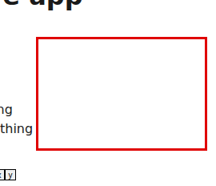
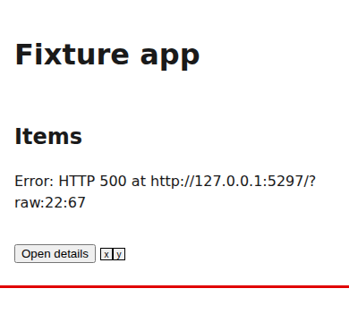

# How to write a flow

**Start here (30 seconds).** A flow is a short script of what a person or an agent does with your product: open the page, press a button, read the dialog. flow-review runs it at every screen size, theme and motion setting you list, and measures each step with fixed checks, so nobody has to eyeball a screenshot to know whether it's right. You write the steps as data; the engine does the measuring. Copy the fixture flow below, change the URL and the names, and run it. The [README](../README.md) is the full reference; this guide is the path to a good first flow and the mistakes that cost us time.

Words used here:

- **Cell:** one combination of viewport, theme and reduced motion. A flow with 3 viewports and 2 themes runs in 6 cells.
- **Unit:** one cell of one flow, the thing shards share out.
- **Finding:** one check's result at one step in one cell, pass or fail, with what it measured.
- **Moment:** an empty, loading, error, first-run or success state, and whether it carries its designed treatment.

## Your first flow in five minutes

Run the fixture flow that ships with the engine:

```sh
git clone https://github.com/ourostack/flow-review && cd flow-review
npm ci && npx playwright install --only-shell chromium
node bin/flow-review.mjs run 'test/fixtures/flows/*.flow.{ts,json}' --fail-on none
cat report/summary.md
```

That runs both fixture flows, a web one and an agent one. Here's the web flow ([`test/fixtures/flows/web.flow.ts`](../test/fixtures/flows/web.flow.ts)). Its page has defects on purpose, so the report has failures to read:

```ts
import { defineFlow } from "@ourostack/flow-review";

export default defineFlow({
  name: "Fixture: open details",
  surface: "web",
  app: { start: "node test/fixtures/serve.mjs 5297 test/fixtures/site", url: "http://127.0.0.1:5297/" },
  matrix: { viewports: ["390x844", "1280x800"], themes: ["light", "dark"], reducedMotion: [true] },
  steps: [
    { id: "open", goto: "/" },
    { waitFor: { text: "First thing" } },
    { capture: { moment: "list" } },
    { id: "details", act: { role: "button", name: "Open details", verb: "click" }, expect: { role: "dialog", name: "Details" } },
    { capture: { moment: "dialog", region: { role: "dialog" } } },
    { tabTraverse: true },
    { act: { verb: "press", key: "Escape" }, expect: { focus: { role: "button", name: "Open details" } } },
    { id: "empty", goto: "/", route: { "**/data.json": { json: { items: [] } } }, state: "empty" },
    { id: "error", goto: "/", route: { "**/data.json": { status: 500, body: "boom" } }, state: "error", stateRegion: { text: "could not load" } },
    { id: "raw-error", goto: "/?raw", route: { "**/data.json": { status: 500, body: "boom" } }, state: "error" },
  ],
  checks: { designSystem: { marker: "[data-ds]" }, skip: ["jank"] },
  rubric: ["craft"],
});
```

To make it yours, put it in your repository as `flows/<area>/<what-the-person-does>.flow.ts` and change four things: `app` (how to start your product and where it answers), the `steps`, the `matrix`, and `checks` (set your own design system's marker, or remove `designSystem`).

## Write the steps like a person

- **Name what a person sees.** Target by role and accessible name first (`{ role: "button", name: "Open details" }`), visible text next, and a CSS selector only as a last resort. If you can't name a control, a screen reader can't either, and that's a finding in itself.
- **Say what should happen.** Give every `act` an `expect`: the dialog that opens, the text that appears, where focus lands. A click that "worked" but opened nothing is the bug you're looking for.
- **Capture where the design matters.** Most checks run at each `capture`, so capture the first screen, each open dialog and each state, with a `region` when only part of the page is new.
- **Walk the keyboard once.** One `tabTraverse` per screen that matters checks every stop is reached, ringed and not trapped.
- **Declare the states.** Use `route` to serve an empty list, a server error or a failed request (`abort: true`), and mark the step with `state`. The `states` check fails a raw error ("HTTP 500", a stack) or a state with too few words to help.
- **One job per flow.** "Read the list", "open an item", "recover from an error". Short flows fail clearly and shard evenly.

## An agent flow

The same idea for a command-line tool or an API: run it and say what the output must be.

```json
{
  "schema": "flow-review/0",
  "name": "Inbox: list today's items",
  "surface": "agent-cli",
  "steps": [
    { "id": "list", "run": ["today", "--json"], "expect": { "exit": 0, "jsonShape": ["items", "items[].id", "items[].subject"], "maxMs": 2500 } },
    { "id": "bad-flag", "run": ["today", "--colour"], "expect": { "exit": 2, "stderrRules": ["oneLine", "namesFix", "noStack"] } }
  ]
}
```

The command each `run` follows (`["node", "${target}"]`, say) and the mock it talks to go in `flow-review.config.json`, so every agent flow shares them. Point `--target` at a release candidate and the same flows gate the release.

## Make it deterministic

Every one of these cost a red run before we learned it.

- **Wait for what you need, not for the network.** A page that holds a stream open (server-sent events, a long poll) never goes "network idle", so waiting for it costs seconds on every `goto` and proves nothing. The default waits for the load event, fonts, images on screen and animations. Follow a `goto` with a `waitFor` on the thing the step needs. Opt into `app.readyAfterGoto: "networkidle"` only for a page that fetches its data after load and holds no stream.
- **Fixtures must speak the protocol.** If the page waits for a handshake on its stream before it shows anything, a route fixture that answers the stream must send that handshake first.
- **Wait for the top layer.** When a modal opens over the page, `waitFor` the dialog, not something underneath it: the thing underneath is there but covered, and the next `act` lands on the overlay.
- **Let it settle before you act.** Resize, theme changes and route swaps re-lay the page. Put a `waitFor` between them and the next `act`.
- **Don't trust one synthetic event.** Browsers can drop a synthetic wheel or scroll event. Assert the result with `expect`, so a dropped event shows as a failed step, not as a flaky measurement later.
- **Freeze time and data.** Serve fixed data from `fixtures.route`. Requests to other origins are blocked by default, so a run never depends on the network. A page that shows "in 58 min" will read "in 57 min" a minute later; pin its clock in the app (the engine doesn't) or check the words around the number.
- **Make collapsed text honest.** A "See more" fold counts as clipped text unless its button says `aria-expanded="false"` and names the fold in `aria-controls`.
- **Give composite widgets one tab stop.** A list or grid that roves focus (one item `tabindex="0"`, arrows inside) passes `keyboard`; the check drives the arrows for you.

## Exceptions and known defects

- **A threshold or skip in a flow is an exception.** Put the reason and an issue number in a comment right above it, and remove it when the issue closes:

  ```ts
  // The board's lane names clip at 390 px until #42 wraps them; each lane's aria-label carries the full name.
  checks: { thresholds: { allowTruncation: true } },
  ```

- **In an agent flow, a defect you've filed but not fixed** gets `known: "#42"` on the step (or `known: { stderrRules: "#42" }` on the flow, keyed by check name). It's reported, not failed. A step's mark that passes again fails the `known` check, so the mark gets removed; a flow-level mark doesn't, so remove it when its issue closes. Web flows have no `known` mark yet: use a commented threshold or `skip`, as above.
- **A flow for a feature that isn't built yet** goes in a folder your workflow leaves out (`flows/pending/`), and moves up when it can run.

## Read the report

`report/summary.md` is the table CI shows:

```markdown
❌ **41 failing** of 235 findings across 5 units (4 human, 1 agent) in 1.8 min. Fail on: `none`.

| Flow | Side | Units | Min | Failing checks |
| --- | --- | ---: | ---: | --- |
| Fixture: agent CLI | agent | 1 | 0.0 | ❌ fields 1 |
| Fixture: open details | human | 4 | 0.3 | ❌ targetSize 16 · deadSpace 12 · designSystem 8 · states 4 |
```

Each failing finding in `findings.jsonl` names its step, cell, selector, measurement and fix, and points at a small crop in `evidence/` with the problem boxed in red:


Notice: the red box is the empty area that failed `deadSpace`: 208×136 px, 58% of the section at 390×844. The fix line reads "fill it, tighten it or let content use the width".


Notice: the error state shows "HTTP 500" and a URL, which a person can't act on. The `states` check fails it and asks for words a person understands.

## Keep it fast

- **Size the matrix to the question.** Phone to 4K, light and dark, is right for a page; a centred sheet that looks the same wider needs two widths, not five. Every cell costs CI time.
- **Record times.** After a run, `npx flow-review times report --out flows/flow-review-times.json`, and commit it. Shards then split by measured time; a new flow's cells with no times count as the median recorded cell, and a slow one will overload its shard.
- **Set time limits.** A cell that hangs is stopped at `timeouts.cellMs` and reported at the step it was on, so the shard still finishes.

## Before you open the pull request

- [ ] `npx flow-review validate` passes (it reads `flows/**/*.flow.{ts,json}`).
- [ ] Every `act` has an `expect`.
- [ ] Every exception has a reason and an issue.
- [ ] It ran locally in one cell (`npx flow-review run <file> --cells 390x844-light-rm`; `npx flow-review list <file>` shows its cell keys) and you read its report.
- [ ] Its cells are in the times file.

When it's in, decide whether its checks should block merges: [gating](gating.md).
